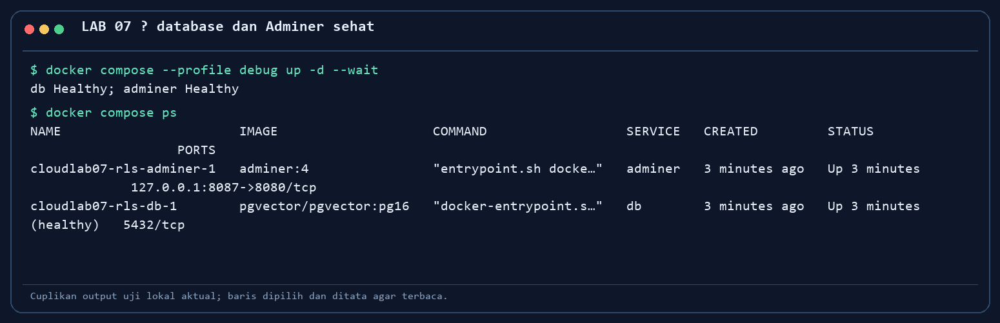
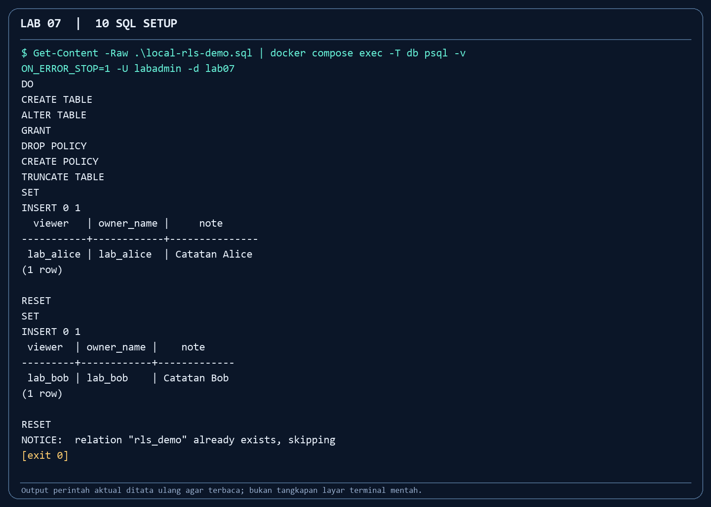
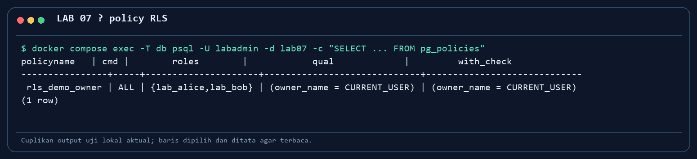
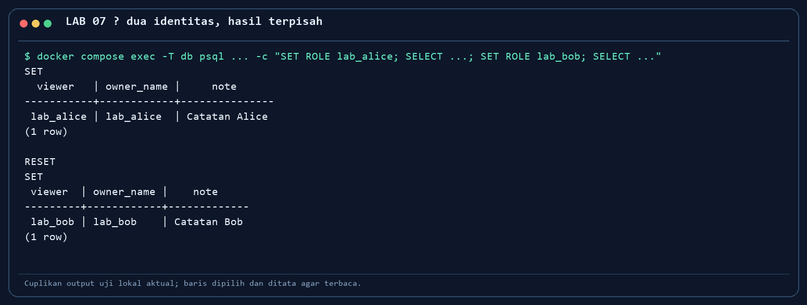
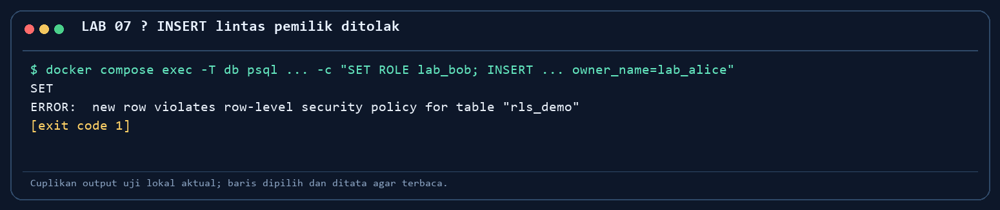
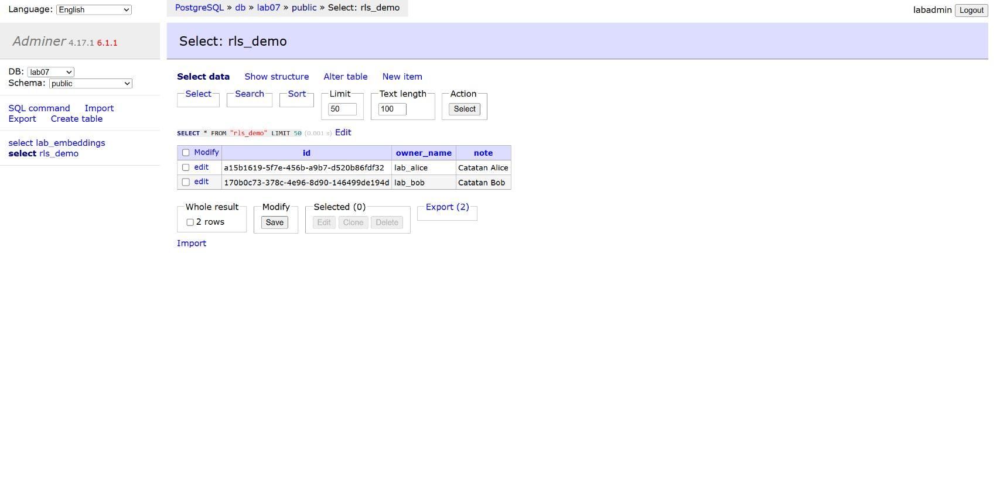
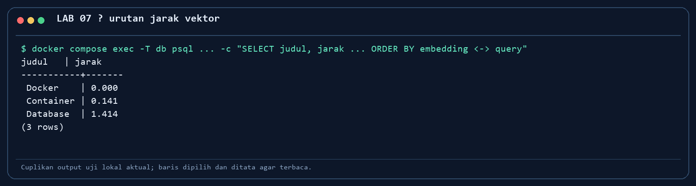
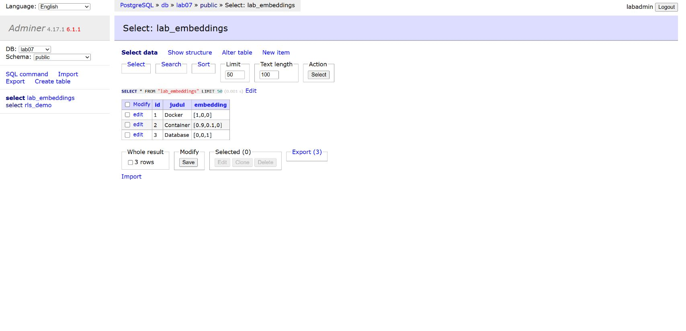

# Lab 07 — RLS dan pgvector di laptop

**Kebijakan kelas:** Lab ini latihan formatif, tanpa tugas, nilai, atau penyerahan terpisah. Satu proyek besar dikerjakan oleh kelompok **3 orang**, dengan presentasi checkpoint minggu 7 (UTS) dan hasil akhir minggu 14 (UAS). Simpan hasil lab hanya bila berguna sebagai referensi atau bukti proses proyek. Baca [brief proyek kelompok](PROYEK_KELOMPOK.md). Bobot resmi tetap mengikuti RPS/LMS.

**Subtopik:** tabel PostgreSQL, otorisasi per baris, Auth versus RLS, serta tipe dan jarak vektor. Jalur utama memakai **PowerShell di Windows + Docker Desktop**. Akun Supabase dan Node hanya diperlukan pada bagian tambahan.

## 1. Siapkan folder dan database

Nyalakan Docker Desktop sampai Engine berjalan. Buka PowerShell di folder tempat menyimpan proyek. Gunakan clone baru agar konfigurasi latihan jelas:

```powershell
git clone https://github.com/SeedFlora/meet7CloudService.git meet7CloudService-local
Set-Location .\meet7CloudService-local
Get-Location
Copy-Item .\.env.example .\.env
docker version
docker compose config --quiet
docker compose --profile debug up -d --wait
docker compose ps
```

`git clone` mengunduh materi. `Set-Location` masuk ke repo: hasil `Get-Location` harus berakhir dengan `meet7CloudService-local`. Semua perintah berikut dijalankan dari folder itu. `Copy-Item` membuat satu konfigurasi lokal. `docker version` harus menampilkan Client dan Server. `config --quiet` tidak menghasilkan teks saat konfigurasi valid. `up --wait` menunggu database siap, lalu `ps` harus memperlihatkan `db` healthy dan `adminer` Up.

Buka `.env` di VS Code. Nilai `POSTGRES_PASSWORD` adalah password contoh latihan lokal. Biarkan variabel Supabase kosong. `.env` diabaikan Git. Pada clone lama dengan volume berisi data, pertahankan password awal; mengubah `.env` tidak mengganti password di database yang sudah terbentuk. Compose tetap memakai nama proyek dan volume yang sama. File lama `secrets/db_password.txt` boleh tetap tersimpan, tetapi Compose revisi ini tidak membacanya.



*Acuan hasil versi sebelumnya: `db` healthy dan `adminer` Up pada port 8087. Konfigurasi sekarang memakai `.env`. Nama container, waktu, dan patch image dapat berbeda. Screenshot terminal dalam repo menata ulang output uji terdahulu dan bukan bukti bahwa perintah sudah berjalan di laptop Anda.*

## 2. Buat dua identitas dan policy

Kasusnya satu tabel menyimpan catatan Alice dan Bob. Masing-masing hanya boleh melihat catatannya sendiri.

```powershell
Get-Content -Raw .\local-rls-demo.sql | docker compose exec -T db psql -v ON_ERROR_STOP=1 -U labadmin -d lab07
```

`Get-Content -Raw` membaca SQL dan meneruskannya ke `psql` di container. `-T` menerima input pipe tanpa terminal interaktif. `ON_ERROR_STOP=1` menghentikan eksekusi saat SQL gagal. Script membuat role `lab_alice` dan `lab_bob`, tabel `rls_demo`, GRANT, policy, dan dua catatan. Script mengosongkan **tabel demo ini saja** saat diulang; gunakan tabel ini untuk latihan.



*Hasil yang dibaca: policy terbentuk dan query akhir menampilkan satu catatan untuk setiap role. `NOTICE` bahwa objek sudah ada dapat muncul saat pengulangan. [Output acuan](screenshots/10_sql_setup.txt).*

Periksa policy:

```powershell
docker compose exec -T db psql -U labadmin -d lab07 -c "SELECT policyname, cmd, qual, with_check FROM pg_policies WHERE tablename='rls_demo';"
```

`USING` menyaring baris yang boleh dibaca/diubah. `WITH CHECK` memeriksa pemilik baris baru atau hasil perubahan. Keduanya membandingkan `owner_name` dengan `CURRENT_USER`. GRANT memberi izin memakai tabel; policy menentukan baris yang diizinkan.



*Hasil yang diharapkan: policy `rls_demo_owner` dan kedua ekspresi pemilik tampil.*

## 3. Buktikan akses per pengguna

```powershell
docker compose exec -T db psql -v ON_ERROR_STOP=1 -U labadmin -d lab07 -c "SET ROLE lab_alice; SELECT current_user AS viewer, owner_name, note FROM rls_demo; RESET ROLE; SET ROLE lab_bob; SELECT current_user AS viewer, owner_name, note FROM rls_demo;"
```

`SET ROLE` mengganti identitas yang dipakai PostgreSQL dalam koneksi tersebut. Alice harus menerima **hanya Catatan Alice** dan Bob **hanya Catatan Bob**. Inilah bukti RLS, bukan jumlah baris yang terlihat saat login sebagai administrator.



Sekarang uji aturan penulisan:

```powershell
docker compose exec -T db psql -v ON_ERROR_STOP=1 -U labadmin -d lab07 -c "SET ROLE lab_bob; INSERT INTO rls_demo (owner_name,note) VALUES ('lab_alice','Percobaan silang');"
```

Hasil yang benar adalah pesan **`new row violates row-level security policy`** dan exit code bukan nol. Bob mencoba membuat catatan atas nama Alice, sehingga `WITH CHECK` menolak. Tidak perlu memperbaiki policy agar percobaan ini sukses.



## 4. Baca tabel lewat Adminer

1. Buka <http://127.0.0.1:8087/> di Chrome.
2. Pilih sistem **PostgreSQL**, server `db`, user `labadmin`, dan database `lab07`.
3. Isi password dari `POSTGRES_PASSWORD` di `.env`, lalu login.
4. Pilih tabel `rls_demo`, kemudian **select**.



Adminer menampilkan **dua baris** karena `labadmin` adalah owner tabel dan owner melewati RLS secara default. Role Alice/Bob pada langkah 3 tetap mendapat satu baris. Password tidak perlu ditampilkan pada screenshot pribadi.

## 5. Cari vektor terdekat

```powershell
Get-Content -Raw .\vector-local-demo.sql | docker compose exec -T db psql -v ON_ERROR_STOP=1 -U labadmin -d lab07
```

Script mengaktifkan extension `vector`, membuat tiga vektor berdimensi 3, lalu menghitung jarak Euclidean terhadap `[1,0,0]` menggunakan operator `<->`.

| Urutan | Dokumen | Jarak yang diharapkan |
|---|---|---|
| 1 | Docker | 0 |
| 2 | Container | sekitar 0,141 |
| 3 | Database | sekitar 1,414 |



Angka ini **vektor mainan untuk memahami operator**, bukan embedding model bahasa. Lab 11 memperkenalkan embedding untuk RAG. Di Adminer, pilih `lab_embeddings` untuk melihat isi vektornya. Urutan kemiripan dibuktikan oleh query `ORDER BY`, bukan urutan tampilan tabel.



## 6. Pembahasan dan selesai

| Pertanyaan | Jawaban |
|---|---|
| Mengapa GRANT saja tidak cukup? | GRANT memberi akses pada tabel. Policy RLS membatasi baris menurut identitas. |
| Mengapa admin melihat dua baris? | Owner tabel melewati RLS secara default. Uji per pengguna memakai role terbatas. |
| Apa beda USING dan WITH CHECK? | USING memeriksa baris lama; WITH CHECK memeriksa baris baru/hasil perubahan. |
| Apakah lokal ini sudah memakai Supabase Auth? | Belum. Identitas lokal adalah role PostgreSQL `current_user`; Supabase memakai JWT dan `auth.uid()`. |
| Mengapa Docker paling dekat? | Vektornya sama dengan query sehingga jaraknya 0. |

Hentikan container dari folder Lab 07:

```powershell
docker compose --profile debug down
```

Container dan jaringan berhenti, volume `db_data` tetap ada. Jalankan kembali `up -d --wait` untuk membuka data. Flag `-v` menghapus volume; flag itu tidak dipakai pada alur ini.

## Tambahan A. Checker dan bukti pribadi

Praktik inti sudah selesai. Checker berikut mengulang sepuluh pemeriksaan dan membuat satu percobaan INSERT yang harus ditolak:

```powershell
& .\tests\challenge.ps1
```

Target `Lab 07: 10 PASS, 0 FAIL`. Checker adalah alat bantu tambahan, bukan langkah setup. Nyalakan database serta jalankan kedua SQL sebelum memakainya. Laporan dan push ke repo pribadi tidak wajib. Template catatan ada di [hasil/TEMPLATE_LAPORAN.md](hasil/TEMPLATE_LAPORAN.md); simpan screenshot hasil sendiri bila membantu proyek kelompok.

## Tambahan B. Supabase Auth, RLS, dan Storage

Bagian cloud terpisah ini memerlukan akun/proyek Supabase dan Node **22+**. Database lokal tetap memakai langkah 1–5. Dokumentasi [Supabase Auth](https://supabase.com/docs/guides/auth) dan [RLS](https://supabase.com/docs/guides/database/postgres/row-level-security) menjelaskan konsep cloudnya.

1. Buat proyek di dashboard Supabase. Buka **SQL Editor**, tempel isi `schema.sql`, lalu jalankan. Schema ini merujuk `auth.users`, sehingga khusus Supabase.
2. Pada **Connect/API settings**, salin Project URL dan **publishable key**. Isi `SUPABASE_URL` dan `SUPABASE_PUBLISHABLE_KEY` pada `.env` Lab 07. Pertahankan `POSTGRES_PASSWORD` lokal. Isi `LAB_EMAIL` dan `LAB_PASSWORD` dengan akun latihan.
3. Dari folder Lab 07, jalankan:

```powershell
node --version
npm --version
npm ci
node --env-file=.env client-demo.mjs --signup
```

Node harus menunjukkan versi 22 atau lebih baru. Signup mengirim pendaftaran. Selesaikan konfirmasi email yang diminta proyek, lalu:

```powershell
npm run demo
```

Klien masuk dengan password, mendapat JWT pengguna, menyertakan `user_id` yang cocok saat INSERT, lalu membaca baris melalui RLS. Hasil `allBelongToMe: true` membuktikan semua baris yang diterima milik akun aktif. Ulangi dengan akun latihan kedua setelah mengganti `LAB_EMAIL` dan `LAB_PASSWORD`; jumlah baris tiap akun dapat berbeda.

4. Untuk Storage, buat bucket **private** bernama `lab07-private` melalui menu **Storage**. Upload file latihan lewat dashboard, lalu periksa bahwa bucket tidak menyediakan akses publik. Upload admin melalui dashboard belum membuktikan policy pengguna. Akses objek dari aplikasi memerlukan policy Storage tersendiri; jangan mengklaim policy tabel `notes` melindungi file Storage.
5. `vector-setup.sql` mengaktifkan extension vector pada proyek. Jalankan lewat SQL Editor untuk mengenali extension yang sama dengan praktik lokal.

Publishable key mengidentifikasi aplikasi, sedangkan JWT setelah login mengidentifikasi pengguna. Request anonim tanpa sesi pengguna tidak boleh dianggap sebagai INSERT yang sukses pada tabel ini. `user_id` wajib dan policy memerlukan role `authenticated`. Jangan memasukkan service role/secret key ke frontend atau Git. Screenshot cloud harus berasal dari proyek sendiri dan menyamarkan email, token, serta password.

## Kendala umum

| Gejala | Langkah pemeriksaan |
|---|---|
| Compose meminta POSTGRES_PASSWORD | Buat `.env` dari contoh di root repo dan isi password lokal. |
| Docker hanya menampilkan Client | Nyalakan Docker Desktop dan tunggu Engine siap. |
| Adminer menolak password pada volume lama | Gunakan password saat database pertama kali dibuat; perubahan `.env` tidak mengubah password volume lama. |
| Adminer tidak terbuka | Jalankan profile debug dan buka port 8087. |
| `auth.users` tidak ditemukan | Pakai `local-rls-demo.sql` untuk lokal; `schema.sql` hanya Supabase. |
| Tabel/vector belum ada | Jalankan kedua SQL berurutan seperti langkah 2 dan 5. |
